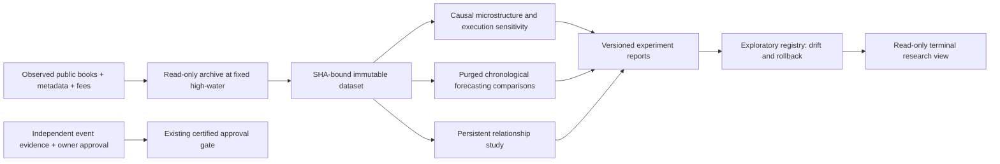

# Phase 11 research architecture

The research boundary has no order, approval, wallet or account mutation interface.
The existing collector and both paper accounts continue independently. Research
can improve a hypothesis or recommend suspension; it cannot certify a strategy.



`research/phase11/contracts.py` defines the interchange. A `ResearchObservation`
contains an actual `OrderBookSnapshot`, optional identity-matched market metadata
available at that book's receipt time, and optional earlier fee evidence. Context
that did not yet exist remains missing. Current category tags may describe a
universe but must not become past predictive features. Event IDs measure shared
membership; they do not prove independence. Book replay verifies original payload
SHA-256, actual full-depth bases, deltas and receipt identity. Historical midpoint
series never become executable depth.

An `ExperimentSpec` records hypothesis, source dataset hash, feature and target
versions, chronological intervals, grouping, cost assumptions, failure conditions
and limitations. No result may grant certification or automatic promotion.
Horizon bid marks, direction probabilities and terminal settlement probabilities
have distinct targets and metrics. Terminal Brier/log loss remain unavailable
without qualified point-in-time outcomes. Repeated quote labels cannot satisfy
100 independent training and 100 independent held-out events.

The coordinator verifies a frozen dataset, executes microstructure, forecasting
and relationship studies in a maximum two-process spawned pool, and records real
worker PIDs, task intervals and observed overlap. Numerical worker threads are
limited to one. Source hashes and every output hash bind the run. A different
window or code version produces a different research version. The same inputs
permit deterministic quantitative replay; generation times/PIDs are operational
metadata, not model outputs. New runs use new directories and preserve prior
artifacts. No cleanup or archive overwrite is automatic.

The separate SQLite research registry records immutable versions and a chained
audit. Models worse than their baseline are suspended in the research registry.
Other candidates remain exploratory even when their measured error improves.
Changes between windows are descriptive drift, with overlapping samples explicitly
flagged. Rollback changes only the selected *research* version and preserves all
old versions; it never changes operational strategy registration or either paper
account. Four unsupported families are suspended from executable research
selection until their prerequisites exist; terminal-outcome certification still
requires independent evidence and explicit owner approval.

`research-experiment` evaluates one frozen dataset. `research-watch` repeatedly
extracts newly accumulated observations, runs comparisons and persists drift;
its invocation can be bounded by `--cycles`. It is an explicit foreground research
loop, not a newly deployed service. Existing paper services only read the latest
integrity-checked research summary. Read failures, malformed reports or missing
metrics produce an unavailable state; they cannot enable trading.

Bounds: at most 30,000 observed book records per dataset, 512 MiB aggregate watch
artifacts, 8 GiB free-disk floor, 32 research versions, two CPU workers and one
numerical thread per worker. Budget exhaustion preserves evidence and stops the
research loop. Current paper service archive budgets and risk limits are unchanged.
Indefinite history retention/rotation is a separate capacity decision.

Examples:

```
uv run neraium-poly research-experiment \
  --dataset data/phase11/dataset-v1 --output data/phase11-results/run-v1 --workers 2
uv run neraium-poly research-watch \
  --database data/experimental-paper/events.sqlite \
  --research-output data/phase11-adaptive --max-observations 10000 \
  --cycles 2 --interval 30 --workers 2
uv run neraium-poly monitor --view research
```

Exchange references checked 2026-11-06: [public stream](https://docs.polymarket.com/market-data/realtime-data),
[price history](https://docs.polymarket.com/api-reference/markets/get-prices-history),
[fee curve](https://docs.polymarket.com/trading/fees). The existing paper broker's
conservative fee bound remains unchanged; exact-curve and zero-fee sensitivity
cases are explicitly research counterfactuals unless actual timestamped schedules
support them. Passive fills require queue evidence that displayed books alone do
not provide. No maker rebates or hypothetical arbitrage are booked as profits.
