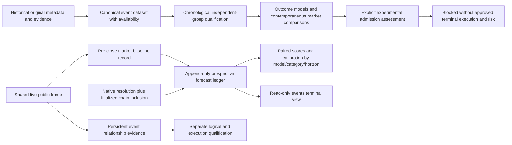

# Phase 12 event probability intelligence

Event-outcome research is separate from both financial ledgers. The only automatic
forecast producer is an observed-market baseline. Independent predictions need
reviewed model/evidence inputs; neither forecasts nor research scores grant trading
authority. Existing certified approval, risk limits, capital and histories remain.



`research/phase12/contracts.py` defines event propositions, evidence, forecasts and
verified outcomes. Stable parent event IDs and market/token IDs are preserved;
parent membership alone never proves independence. Each record retains UTC source
and availability times. A hash of current rule text does not prove the historical
rule version. Missing creation/closing/depth/context fields remain explicit.

The canonical dataset binds original bundle, qualification and raw finalized
proofs. It preserves post-resolution download availability rather than backdating
historical price charts. Outcome payout orientation must match the original token
array and independently corroborated CTF payout. Categories distinguish available
historical evidence from prospective research potential. Sports and Weather are
research priorities, not demonstrated profitable segments.

Event models target binary final payouts. Market price, historical frequency,
Bayesian updating and regularized logistic/validation calibration are implemented
with chronological label availability and dependency separation. Actual scores
remain null when prerequisites are missing. Controlled fixtures exercise model
math and scoring; they are never scientific results. No model trains on a future
resolution or becomes an approved strategy automatically.

The existing experimental process owns a separate `event-intelligence` child
store. It records up to six fresh pre-close market baselines every five minutes,
with at most one per market per hour. Baseline probability equals the observed
bid/ask midpoint, explicitly not independent prediction. Full supporting book and
rule snapshots, source/receipt times, cutoff, uncertainty meaning, model/feature
versions and dataset/model/rule hashes remain append-only. Unknown category is
explicit; no title-based category or confidence is invented.

A SQLite journal forbids update/delete and chains record hashes. A separately
persisted coordinator head detects rollback to a valid earlier journal prefix;
valid additional records after a checkpoint are accepted for crash recovery.
Research corruption or unavailable source evidence withholds event inference;
it does not reset capital or alter the existing paper account. The event view
shows unavailable metrics rather than plausible zeros.

A background check inside the existing service considers at most one ended
pending forecast per five minutes. Scheduled closing only triggers a query.
Native final resolution, matching rules/token payout and finalized Polygon CTF
log/receipt/canonical block must agree before recording an outcome. Raw public
responses and acquisition manifests are retained and independently replayed.
Unverified, disputed, unsupported or missing evidence leaves the forecast pending;
preparation/lifecycle timestamps never stand in for settlement time. Research
scoring never calls account settlement or records cash returns.

Repeated forecasts do not create independent events. Scores group by dependency,
model hash, feature version and kind; model comparisons use the contemporaneous
market probability on the same forecast, not an earlier baseline snapshot.
Category/horizon/rolling reports remain descriptive until independent evidence
supports stronger conclusions. Corrections conflict with finalized records and
require separate review, never rewriting a past forecast.

The opportunity assessor checks forecast timing, independent calibration,
uncertainty, rule/identity consistency, fees, spread, depth and small-position
capacity. It explicitly rejects market-only estimates and unsupported terminal
execution. The existing broker supports horizon marks: a terminal probability
must never be relabeled a future bid to bypass that restriction. No event strategy
is enabled and no qualified model exists in this phase. This capability block is
a disclosed limitation, not hidden order activity.

Bounds: selected existing public coverage, maximum 20,000 forecast-journal records,
64 MiB journal by default, separate bounded resolution-proof storage, 8 GiB disk
floor, six baseline records/cycle, two CPU workers/research job and one numerical
thread per worker. Exhaustion preserves evidence and withholds further research.
No new daemon/service or public deployment is introduced.

```
uv run neraium-poly event-research \
  --dataset data/phase12/dataset-v3 --output NEW_OUTPUT --workers 2
uv run neraium-poly monitor --view events
```

Official references checked 2026-11-06: [resolution rules and finality](https://docs.polymarket.com/concepts/resolution),
[public stream](https://docs.polymarket.com/market-data/realtime-data),
[NWS independent weather data](https://www.weather.gov/documentation/services-web-api).
These describe sources; they do not certify the collected data or a model.
