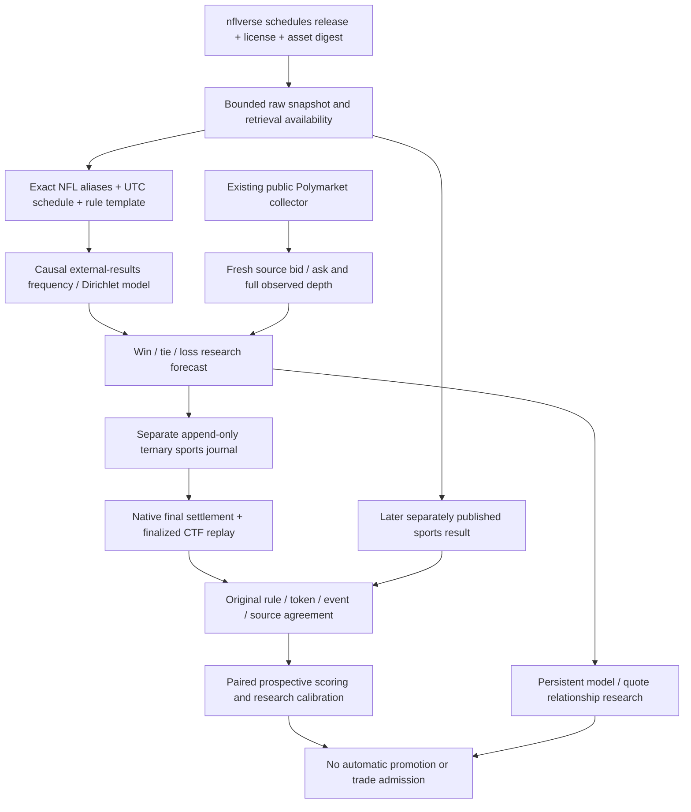

# Independent sports probability research

Phase13 adds independently informed prospective research to the Phase12 event
intelligence system. Neither journal grants order, settlement-of-capital, strategy
approval or certified-model authority.



## Contracts and units

`research/phase13/contracts.py` records source artifacts, normalized games,
deterministic mappings and independent model results. Source event/publication,
actual retrieval and first verified availability are separate. Retrieval never
backdates historical context. Every external payload has an exact content hash.
`phase12/contracts.py::SettlementProofReference` binds proof acquisition to the
original ternary journal hash without constructing a fictitious binary forecast.
It is a read-only locator and cannot enter binary forecast admission.

A winner contract with 50/50 tie settlement has an expected payout quote, not an
unconditional probability of a team winning. NFL models therefore retain three
outcomes. `P(win)` and `P(win)+0.5*P(tie)` have different names and are never
silently exchanged. Cancellation/no-result risk is an additional limitation of
the expected payout calculation. The price does not supply a market W/T/L vector.

## Ownership and lifecycle

The existing experimental process owns Phase12's ledger and a separate child
sports journal. Sports research reads the complete existing bounded public frame;
the experimental strategy universe, account, risk limits and broker are unchanged.
Only exact supported pre-start match-winner mappings qualify. Source-free,
stale, ambiguous, spread/total, canceled and postponed contracts withhold.

The sports source refresh defaults to twelve hours, with a bounded five-minute
retry after failure, 64MiB aggregate child budget, 12MiB acquisition reserve and
8GiB free disk floor. Individual journal records are capped at 128KiB; journal
storage is capped at 16MiB and 10,000 records. Source aliases/hardlinks and escaped
paths reject. Exhaustion preserves evidence and withholds new research. No
unrelated cleanup or infrastructure change is needed.

The paper archive retains its original 512MiB stop. If that archive fills, paper
admission stays stopped while the separately bounded sports researcher may still
read public frames and check existing forecasts. This never creates paper orders
without their required execution evidence. Research failures do not grant trading
authority. Existing forecast chains and separate coordinator anchors survive
restart; immutable journal-derived daily dedup also covers append-before-checkpoint
crashes. A daily forecast per market/model is not another independent event.

## Verification and learning

Native Polymarket final payout and canonical finalized Polygon CTF inclusion must
agree with the original rules, token and immutable forecast reference. The sports
publisher's later result must corroborate that payout. This is not an official
NFL result oracle or independently operated blockchain node. Disputes, ties,
cancellations, unknown versions, corrections and ambiguous results stay unresolved.
A future typed fractional-outcome proof schema is required to resolve tie refunds.

Original source bytes, mapping, model and exact sports-result record are replayed
before scoring; source corrections suspend affected results without rewriting
history. The evaluator deduplicates sports game and reviewed dependency group.
It compares expected-payout squared error to the same recorded market quote;
multiclass Brier/log loss remain distinct, and market win-probability scores stay
null without a contemporaneous market distribution. Statistical headline scores
require sufficient independently reviewed events; descriptive scores are separately
labeled. Calibration does not prove superior forecasting or executable profit.

ResearchRegistry supplies append-only model/version comparisons, explicit research
selection rollback and drift tracking. It has no operational promotion effect.
Source/model replay currently uses the selected code version; after an upgrade,
older forecasts may withhold scoring pending explicit version-specific replay or
rollback. All source revisions and original evidence remain preserved.

## Reproducible studies

```bash
uv run neraium-poly sports-research \
  --dataset data/phase13/source-capture-v3 \
  --manifest data/phase13-operations/research-frame.json \
  --output data/phase13-results/NEW_RUN --workers 2
uv run neraium-poly monitor --view events
```

The market frame is a frozen authentic input, not a replay claimed as live
operation. Study estimates are not registered prospective forecasts. The runtime
journals actual newly generated prospective forecasts separately. Experiments
record dataset/model hashes, cutoff, availability, features, missingness, source
and cost limitations, null unsupported metrics and actual process intervals.
Model prices are never features. Synthetic HTTP/RPC/match fixtures only verify
software behavior and never enter observed research counts.
