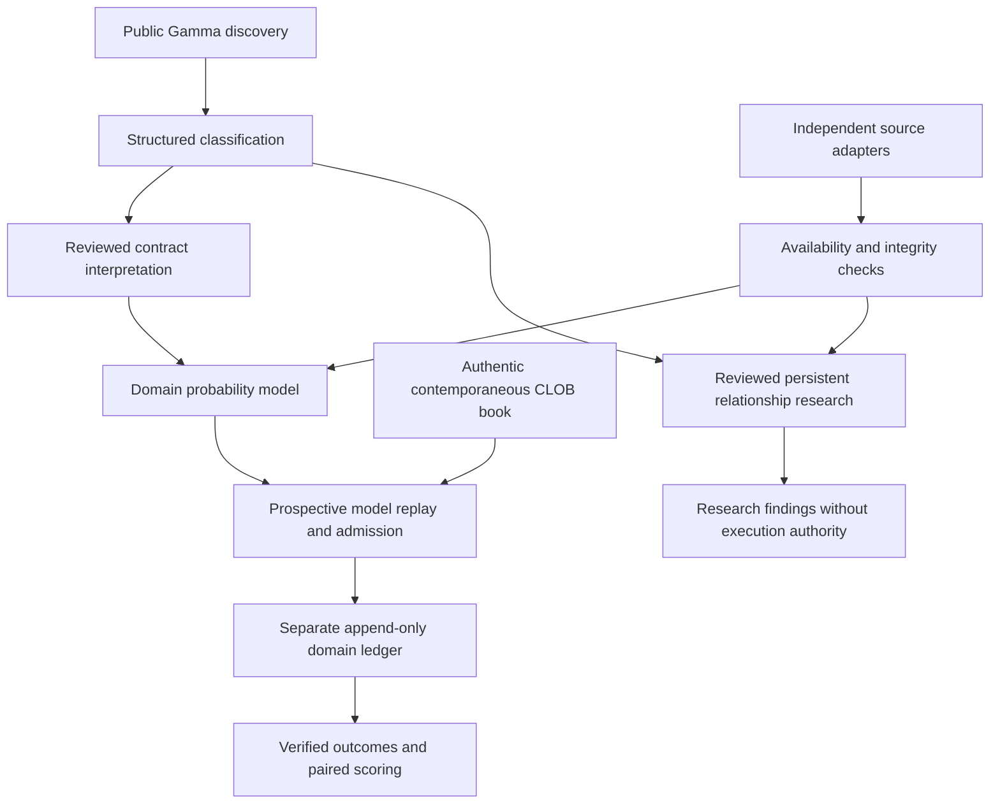

# Universal prediction intelligence

Phase14 separates public discovery, domain classification, resolution semantics,
external evidence, forecasting, relationship research, outcome verification and
execution authority. Sports remains one adapter; existing journals are unchanged.

`research/phase14/contracts.py` defines `DomainMarket`, `DomainContract`,
`DomainEvidence`, `DomainForecast` and the `DomainModel` protocol. Binary event
probabilities, expected payouts and outcome distributions have distinct semantics.
Every forecast binds model/feature/data hashes, domain, uncertainty, rule hash,
causal evidence cutoff, external provenance and original contemporaneous book.
Polymarket probabilities are comparison baselines, never hidden independent inputs.

The universal child ledger uses the existing hash-chained SQLite engine with
exclusive ownership, bounded records/bytes and rollback anchors. Legacy Phase12
and Phase13 record formats are untouched. Stored forecasts replay their original
model derivation; unknown model versions fail closed. Stored outcome proof hashes
and forecast matching are validated. After restart, source proofs and independent
domain corroboration must replay before an outcome counts as resolved. Missing or
corrected evidence leaves immutable records under review. No universal independent
outcome verifier is approved yet; this is a deny-by-default extension interface.

Weather, crypto and economic adapters implement actual source acquisition.
General political/technology/science/cultural contracts require interpretation
review. Legacy NFL ternary forecasts are projected read-only, without duplicate
records or invented binary probabilities. See the domain reports for exact scope.

`DomainResearchRuntime` runs inside the existing experimental process. It checks
the8GiB filesystem floor before opening a durable child journal or collecting new
source evidence. A degraded diagnostic transport may classify cached metadata,
but removes books, fee observations, relationship findings and evidence. Normal
execution transport still rejects degraded producers. Unrecovered history counts
remain unknown rather than falsely zero. Checkpoints preserve existing anchors.

`UniversalRelationships` distinguishes reviewed statistical relationships,
persistent shifts and reviewed logical constraints. It requires causal windows,
aligned source times, uncertainty and persistence. No reviewed cross-domain
relationship definitions or real findings have been acquired in this phase.
Findings cannot establish causation, forecasting superiority or executable profit.

The model registry and `admission.py` confer no trading authority. New models
remain research-only even when their source/model tests pass. Experimental orders
still need explicit strategy admission, executable depth, conservative costs,
uncertainty/calibration checks and existing risk approval. The certified account
and100training/100held-out independent-event gate plus owner approval are unchanged.

Research evaluation pairs original forecasts with their own contemporaneous market
books and independently verified outcomes. Event and dependency-group deduplication
prevent token/forecast multiplication. Headline research metrics require20reviewed
independent events; this does not replace certified requirements. Nonbinary scores
are separate. Missing data produces null metrics, never fixture-derived accuracy.

Operations: `monitor --view domains` adds narrow-terminal category counts,
capabilities, forecast status, warnings and both accounts. `--view events` and
`--view research` remain available. `domain-research --output PATH --workers 2`
replays bounded real captures into versioned reports with hashes and actual worker
PIDs. RAM captures are explicitly volatile and cannot support durable forecasts.

Current limitations: crypto's precise noon-candle convention needs review;
weather lacks station-matched calibrated predictive distributions; economics lacks
qualified release vintages. New domain result verifiers, reviewed relationship
definitions, calibration cohorts and approved storage remain necessary. The
30-minute general source refresh also cannot support a future crypto model's
two-minute freshness requirement without a separately reviewed refresh schedule.
